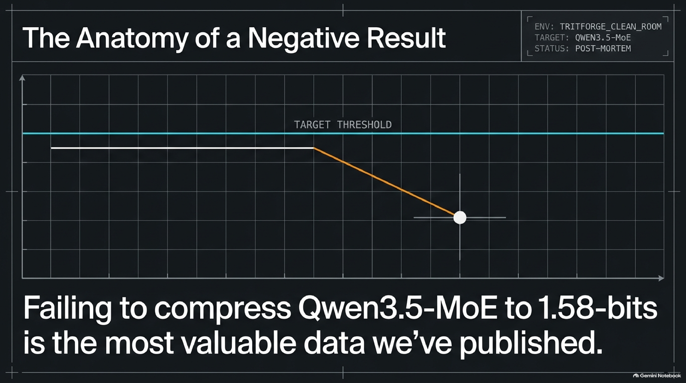
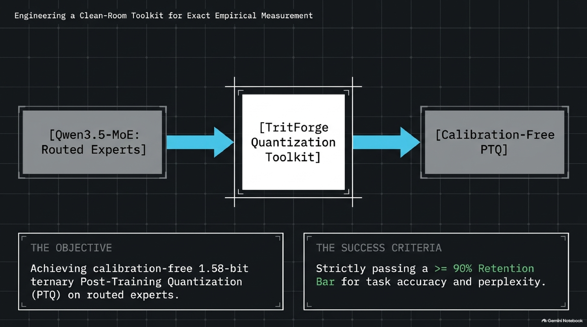
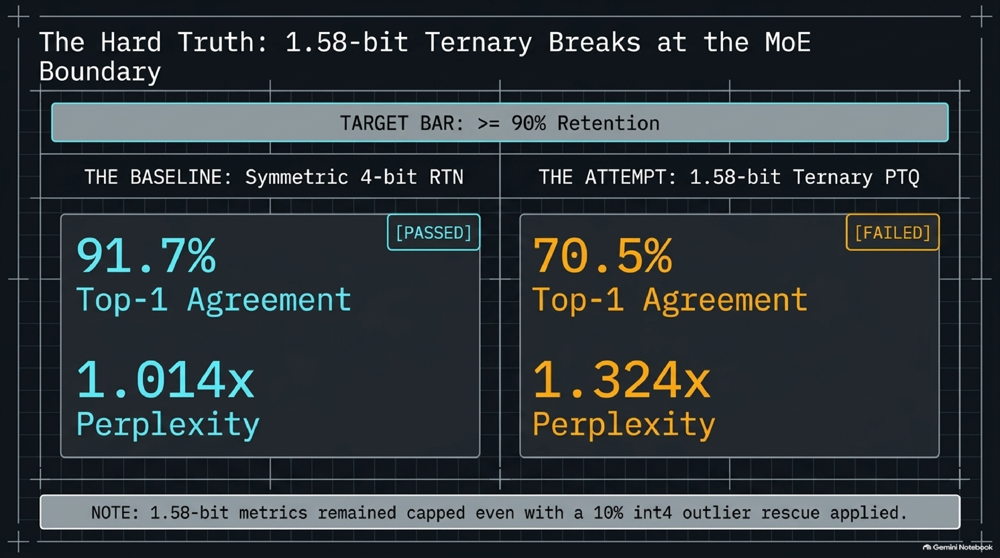
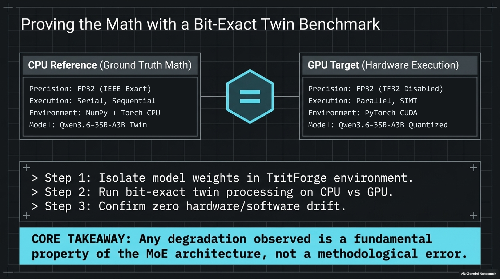
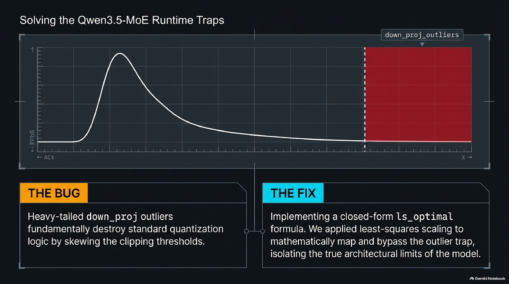
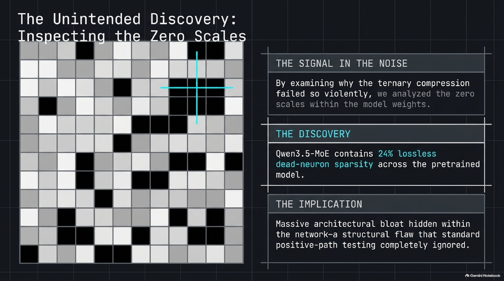
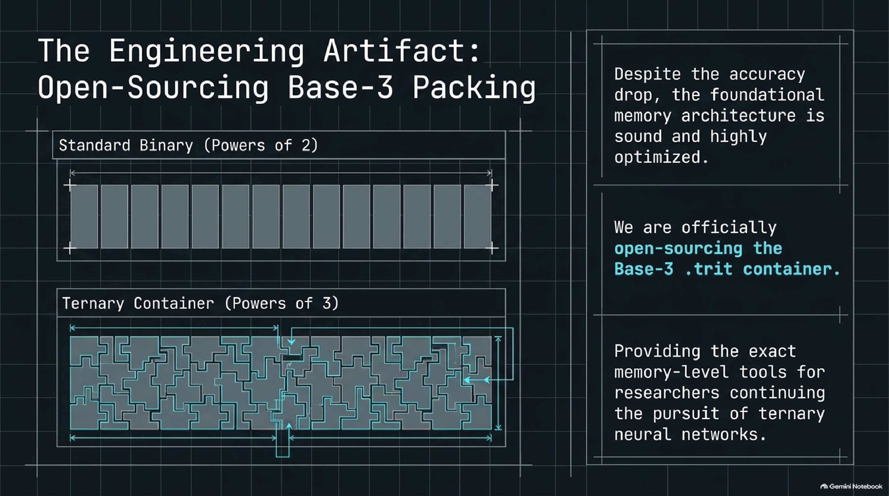
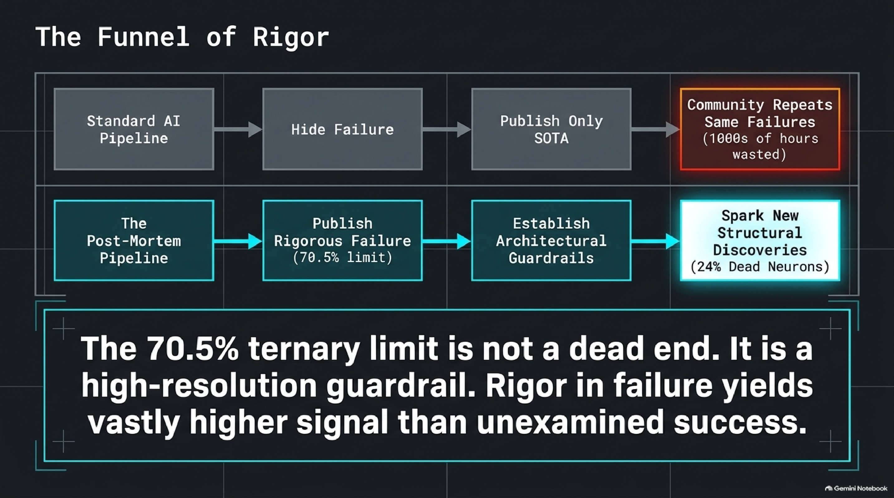

# TritForge

<p align="center">
  
</p>

<p align="center">
  <b>An Empirical Post-Mortem on 1.58-Bit Ternary Post-Training Quantization for Sparse Mixture-of-Experts Models</b>
</p>

<p align="center">
  <a href="LICENSE"></a>
  <a href="pyproject.toml"></a>
  <a href="tritforge/"></a>
  <a href="experiments/twin_eval/"></a>
  <a href="assets/audio/TritForge_Audio_Overview.m4a"></a>
</p>

> **Audio Overview (4:24):** [**Listen to or download the engineering post-mortem (`TritForge_Audio_Overview.m4a`)**](assets/audio/TritForge_Audio_Overview.m4a), which walks through the 70.5% ternary ceiling versus 91.7% 4-bit round-to-nearest (RTN) retention on `Qwen3.5-MoE`, closed-form least-squares outlier scaling (`ls_optimal`), the Base-3 `.trit` container format, and the discovery of 24% lossless dead-neuron sparsity in the pretrained weights.

---

## 1. The Question and the Verdict

In ultra-sparse Mixture-of-Experts (MoE) architectures such as `Qwen3.8-2.4T-A95B-FP8` (92 layers, 512 routed experts per layer) and its 40-layer architectural twin `Qwen3.6-35B-A3B-FP8` (256 routed experts per layer), routed feed-forward networks account for more than 95% of all model parameters. Uniform sub-2-bit quantization across an entire MoE model is known to fail because quantizing the router gating matrices perturbs token dispatch and triggers routing collapse.

**TritForge** was built to test whether strict structural asymmetry could rescue sub-2-bit compression without calibration data or fine-tuning:

> **The Hypothesis:** If we preserve every **Gatekeeper** component (Attention, Gated-DeltaNet linear attention, MoE routers, shared experts, RMSNorms, token embeddings, and the language modeling head) in high precision while quantizing only the routed expert projections (`gate_proj`, `up_proj`, `down_proj`) into **1.58-bit Base-3 ternary trits** ($\{-1, 0, +1\}$ with one `FP16` scale per 128 weights, or `1.725 bits/weight`), can we cut physical expert storage by 72.3% while retaining at least **90% top-1 token agreement** with the unquantized `FP8` baseline?

<p align="center">
  
</p>

### The Verdict: No.

Evaluated end-to-end across all 40 layers of `Qwen/Qwen3.6-35B-A3B-FP8` on held-out text ($4 \times 512$ tokens, $N = 2,044$ next-token predictions, verified bit-for-bit across CPU and GPU in [`experiments/twin_eval/`](experiments/twin_eval/)), **calibration-free 1.58-bit ternary post-training quantization (PTQ) falls well short of the 90% retention bar.**

* **Exact Least-Squares Ternary (`arm2`, `1.725 bits/weight`):** Retains **70.5% top-1 token agreement** and degrades perplexity by **1.3243x** (`15.77` vs. `11.91` control).
* **Hybrid 10% 4-Bit Outlier Rescue (`mix_err` / `mix_kurt`, `1.965 bits/weight`):** Keeping the worst 10% of expert matrices in each layer at 4-bit raises top-1 agreement only to **74.2%–74.4%** (`1.1959x–1.2155x` perplexity).
* **Symmetric 4-Bit Round-to-Nearest (`int4`, group size 128, `4.125 bits/weight`):** Evaluated through the exact same asymmetric pipeline, plain 4-bit RTN achieves **91.7% top-1 token agreement** and a **1.0136x perplexity ratio** (`12.07` vs. `11.91` control).

<p align="center">
  
</p>

We are publishing the negative result, the underlying failure analysis, the unexpected discovery of 24% lossless dead-neuron sparsity in the source weights, and the complete clean-room toolkit so other researchers have exact baselines and reusable tooling.

---

## 2. End-to-End Twin Benchmark (`Qwen3.6-35B-A3B-FP8`)

To eliminate implementation drift before drawing architectural conclusions, we built a layer-streaming evaluation harness ([`experiments/twin_eval/`](experiments/twin_eval/)) on `Qwen/Qwen3.6-35B-A3B-FP8`, which shares the exact `Qwen3.5-MoE` block structure of the 2.4T model (a 3:1 ratio of Gated-DeltaNet linear attention layers to Grouped-Query Attention layers, zero-centered RMSNorms, gated shared experts, and SwiGLU routed experts).

<p align="center">
  
</p>

### Experimental Controls
* **Bit-Exact CPU and GPU Execution:** All forward passes run in exact IEEE `float32` (`TF32` disabled on CUDA), streaming one decoder layer at a time through the reference Hugging Face `Qwen3_5MoeDecoderLayer` implementation. `gpu_quant_check.py` confirms **0 mismatches across 859,832,320 quantized weights** between the NumPy CPU and PyTorch CUDA quantizers, and `gpu_vs_cpu.py` confirms `0.00e+00` relative difference across all evaluation metrics.
* **Unseen Evaluation Corpus:** Four sequences of 512 tokens ($2,048$ tokens total, $2,044$ evaluated next-token targets) drawn from technical prose and code authored after the model's training cutoff and locked via [`SHA256SUMS.txt`](experiments/twin_eval/SHA256SUMS.txt).
* **Asymmetric Isolation:** Across all arms, every non-routed tensor is bit-identical to the `FP8` Control (dequantized exactly per $128 \times 128$ block); only the routed expert projections (`gate_proj`, `up_proj`, `down_proj`) vary.

| Quantization Arm | Routed Expert Bits/Weight | Perplexity (PPL) ↓ | PPL Ratio vs. Control ↓ | Top-1 Token Agreement ↑ | Mean KL Divergence (nats) ↓ | Meets $\ge 90\%$ Target? |
| :--- | :---: | :---: | :---: | :---: | :---: | :---: |
| **Control (`FP8` exact dequant)** | `8.000` | **11.9111** | `1.0000x` | **100.0%** | `0.0000` | Reference |
| **`arm1` (Heuristic ternary `optimal`)** | `1.725` | 16.7450 | `1.4058x` | 68.8% | `0.5351` | **FAIL** |
| **`arm2` (Closed-form LS ternary `ls_optimal`, CPU)** | `1.725` | 15.7743 | `1.3243x` | 70.5% | `0.4592` | **FAIL** |
| **`arm2` (Closed-form LS ternary `ls_optimal`, GPU)** | `1.725` | 15.7742 | `1.3243x` | 70.5% | `0.4592` | **FAIL** |
| **`mix_kurt` (`arm2` + top 10% `int4` by kurtosis)** | `1.965` | 14.4784 | `1.2155x` | 74.4% | `0.3514` | **FAIL** |
| **`mix_err` (`arm2` + top 10% `int4` by squared error)** | `1.965` | 14.2451 | `1.1959x` | 74.2% | `0.3363` | **FAIL** |
| **`int4` (Plain symmetric 4-bit RTN `g128`, CPU)** | `4.125` | **12.0733** | **`1.0136x`** | **91.7%** | **`0.0352`** | **PASS** |
| **`int4` (Plain symmetric 4-bit RTN `g128`, GPU)** | `4.125` | **12.0737** | **`1.0136x`** | **91.7%** | **`0.0352`** | **PASS** |

*Raw JSON outputs and per-layer cosine similarity, relative error, and router overlap traces are stored in [`experiments/twin_eval/results/`](experiments/twin_eval/results/).*

---

## 3. Diagnosis and Structural Findings

### Finding 1: Heavy-Tailed `down_proj` Outliers Erase 10% of Routed Experts Under Heuristic Scaling

<p align="center">
  
</p>

When we audited 368 randomly sampled routed experts across all 92 layers of the `Qwen3.8-2.4T-A95B-FP8` master shards, most expert matrices exhibited well-behaved weight distributions (median relative Frobenius reconstruction error of `0.443` under heuristic scaling versus `0.434` at the exact mathematical optimum). However, **roughly 10% of routed experts at every depth (and 15% with kurtosis $> 20$, concentrated in Layers 0–9 and 70–91) contain extreme heavy-tailed outliers in `down_proj`**.

On these high-kurtosis `down_proj` matrices, standard threshold heuristics set the clipping boundary near the outlier peak, collapsing 99.9% of the weights to zero and producing **`0.89–0.98` relative reconstruction error**. That effectively zeroes out one in ten experts.

To eliminate this failure mode without calibration data, we replaced heuristic scaling with an exact 1D closed-form least-squares optimizer (`ls_optimal` in [`tritforge/quantize.py`](tritforge/quantize.py)). For each 128-weight block $w \in \mathbb{R}^{128}$, sorting $|w|$ in descending order and evaluating the cumulative prefix sums finds the exact number of non-zero trits $k^*$ and scale factor $\alpha^*(k^*)$ that minimize $\|w - \alpha q\|_2^2$:

$$\alpha^*(k) = \frac{1}{k} \sum_{i=1}^{k} |w|_{(i)}, \qquad k^* = \arg\max_{1 \le k \le 128} \frac{\left(\sum_{i=1}^{k} |w|_{(i)}\right)^2}{k}$$

Across high-kurtosis ($> 20$) experts, `ls_optimal` reduces median reconstruction error from **`0.93` to `0.38`** and brings every sampled expert across all 92 layers below `0.60`. In the 40-layer end-to-end benchmark, `ls_optimal` (`arm2`) reduces the perplexity ratio from `1.4058x` (`arm1`) to `1.3243x`, confirming the fix while demonstrating that the remaining error (`70.5%` top-1 agreement, `0.4592` nats KL) is fundamental to 3-state weight resolution.

### Finding 2: Protecting the Worst 10% of Expert Matrices in 4-Bit (`mix_err` / `mix_kurt`) Does Not Rescue Ternary PTQ

To test whether a modest mixed-precision budget could bridge the remaining gap, `mix_kurt` and `mix_err` retain the worst 10% of routed expert matrices in each layer (ranked by kurtosis or by ternary squared error) in 4-bit (`int4` g128) while keeping the other 90% in `ls_optimal` ternary (`1.965 bits/weight` average). While this lowers the perplexity ratio to **`1.1959x–1.2155x`** and lifts top-1 agreement to **`74.2%–74.4%`**, the model still misses the 90% threshold by more than 15 percentage points. The degradation in ternary PTQ is not isolated to a small tail of pathological matrices; it compounds steadily across the bulk of the routed expert ensemble.

### Finding 3: 24% Layer-Averaged Lossless Dead-Neuron Sparsity in Pretrained FP8 Weights

<p align="center">
  
</p>

While auditing `.trit` block-scale tables from the converted 2.4T layers against the raw `FP8` master shards, we found that 38% to 56% of 128-element block scales in early layers were exact zeros. Rather than file corruption, inspecting the source `FP8` tensors revealed **structured dead intermediate channels** in the pretrained model: entire SwiGLU intermediate neurons where row $i$ of `gate_proj`, row $i$ of `up_proj`, and column $i$ of `down_proj` are simultaneously zero (or $\le 1.3 \times 10^{-6}$).

* **Full-Model Census (92 Layers):** On average, **24% of all routed-expert intermediate channels are dead**, ranging from **5%** in Layer 74 to **84%** in Layer 1.
* **Early-Layer Concentration (Layers 0–9):** Dead intermediate channels average **54% per layer**, with individual experts reaching 75% to 90% dead capacity.
* **Ordering Rule for Lossless Pruning:** Dead channels must be pruned **after** block quantization, never before. Removing zero rows or columns prior to quantization shifts 128-element block alignment and alters block statistics on surviving weights. Pruning them post-quantization via a channel index mask yields a **mathematically lossless 24% average reduction** in expert storage and matrix-multiply compute.

### Finding 4: Three `Qwen3.5-MoE` Runtime Pitfalls for Custom Inference Engines

1. **Zero-Centered RMSNorm (`1 + w`):** Unlike standard LLaMA or Qwen2 RMSNorm ($y = \hat{x} \cdot w$), `Qwen3.5-MoE` decoder norms use a zero-centered offset: $y = \hat{x} \cdot (1 + w)$. Because learned norm weights $w$ center near $-0.6$ in Layer 0, applying a standard $\hat{x} \cdot w$ kernel flips the sign of **99.9% of the channels feeding the MoE router**.
2. **3:1 Hybrid Gated-DeltaNet Topology:** Only one in four decoder layers uses standard Grouped-Query Attention (GQA); the other three in four layers use **Gated-DeltaNet linear recurrent attention**.
3. **Flat Pre-Top-K Router Distributions:** On real Layer-0 token activations, the top-10 routed experts capture only **32%** of the full 512-way softmax probability mass prior to top-$K$ renormalization. Reaching 90% cumulative softmax mass requires a median of **$K = 265$ experts** (`10th–90th` percentile: `138–314`). Dynamic-$K$ routing schemes that threshold raw 512-way probability mass at 90% will therefore clamp to `max_k` rather than saving compute, whereas reducing $K$ below 10 alters routed outputs by more than 60%.

---

## 4. Open-Source Engineering Toolkit

<p align="center">
  
</p>

Although calibration-free 1.58-bit ternary PTQ did not meet the accuracy bar on `Qwen3.5-MoE`, the underlying quantization, binary packaging, and verification infrastructure in this repository is clean-room, dependency-light (the core package requires only Python $\ge 3.10$ and `numpy`), and verified by **114 offline unit tests**:

1. **Bit-Exact CPU and GPU Twin Evaluation Harness ([`experiments/twin_eval/`](experiments/twin_eval/)):**
   * Layer-by-layer streaming evaluation over `Qwen3.5-MoE` checkpoints on a single GPU or CPU (`ternary_arms.py`).
   * Bit-exact NumPy and PyTorch/CUDA implementations of closed-form `ls_optimal` ternary and symmetric `int4` quantizers (`gpu_quant.py`, `gpu_quant_check.py`, `gpu_vs_cpu.py`).
2. **Zero-Copy `.safetensors` Binary Slicer and Shard Auditor ([`tritforge/slice.py`](tritforge/slice.py), [`tritforge/verifier.py`](tritforge/verifier.py)):**
   * Parses 8-byte header prefixes across 200+ multi-terabyte `.safetensors` shards in under two seconds without loading tensor payloads into RAM.
   * Automatically resolves cross-shard $128 \times 128$ `weight_scale_inv` `FP8` block scales and decodes `F8_E4M3` and `BF16` in pure NumPy.
   * Enforces a 64 MB header allocation ceiling against malformed files and filters active `.aria2` partial downloads.
3. **Native Base-3 `.trit` Container and Batch Converter ([`tritforge/container.py`](tritforge/container.py), [`tritforge/converter.py`](tritforge/converter.py), [`tritforge/quantize.py`](tritforge/quantize.py)):**
   * Packs 5 balanced trits into each byte ($3^5 = 243 \le 256$, `1.6 bits/trit` plus `0.125 bits/weight` for `FP16` block scales, or `1.725 bits/weight` total), compressing a 512-expert layer from `25.3 GB` in `FP8` shards to `7.01 GB` on disk (`72.3%` reduction).
   * Provides atomic file finalization (`.atomic_tmp` + `os.fsync`), SHA-256 manifest verification (`tritforge verify-trit`), and seek-based single-expert loading.

---

## 5. Installation and Command-Line Usage

### Installation
```bash
git clone https://github.com/adamm285-dev/TritForge.git
cd TritForge
pip install .
```

### Command-Line Interface

```bash
# 1. Audit multi-shard .safetensors headers and byte-offset boundaries
tritforge verify-shards -i /path/to/safetensors_shards

# 2. Convert specific layers into Base-3 .trit containers (using ls_optimal scaling)
tritforge convert -i /path/to/shards -o /path/to/trit_output -l 0

# 3. Verify converted .trit containers and SHA-256 digests against the manifest
tritforge verify-trit -m /path/to/trit_output

# 4. Run analytical storage and memory footprint audit
tritforge audit

# 5. Run synthetic toy-model mechanics demonstration
tritforge demo --prompt "Hello" --max-new-tokens 16
```

> **Scope Note on Standalone Inference (`tritforge run` / `tritforge serve`):**  
> Because `Qwen3.5-MoE` relies on hybrid Gated-DeltaNet linear attention in 3 of every 4 layers, which is not implemented in the standalone NumPy runtime, `tritforge run` exits with a non-zero status code and `/v1/chat/completions` on `tritforge serve` returns `HTTP 501 Not Implemented` rather than serving synthetic responses. For end-to-end `Qwen3.5-MoE` forward evaluation, use the layer-streaming harness in [`experiments/twin_eval/`](experiments/twin_eval/README.md).

### Running the Test Suite

The offline test suite runs in roughly 20 seconds without requiring external model weights (local multi-terabyte shard vault tests marked `@pytest.mark.vault` are deselected by default in [`pyproject.toml`](pyproject.toml)):

```bash
pytest tests -v
```

To reproduce the `Qwen3.6-35B-A3B-FP8` twin evaluation on GPU or CPU, see [`experiments/twin_eval/README.md`](experiments/twin_eval/README.md).

---

## 6. Why We Publish Negative Results

<p align="center">
  
</p>

Establishing a bit-exact negative boundary is just as actionable as reporting a positive benchmark. For practitioners compressing `Qwen3.5-MoE` models today, **symmetric 4-bit RTN (`int4`, group size 128) paired with post-quantization dead-neuron pruning (24% average channel savings)** provides a high-fidelity, calibration-free path (`91.7%` top-1 agreement, `1.0136x` perplexity), whereas pushing routed experts below 2 bits will require activation-calibrated second-order compensation (such as column-wise Cholesky GPTQ over real routed token covariances) or quantization-aware training.

---

## License

Licensed under the **Apache License, Version 2.0**. See [`LICENSE`](LICENSE) for details.
